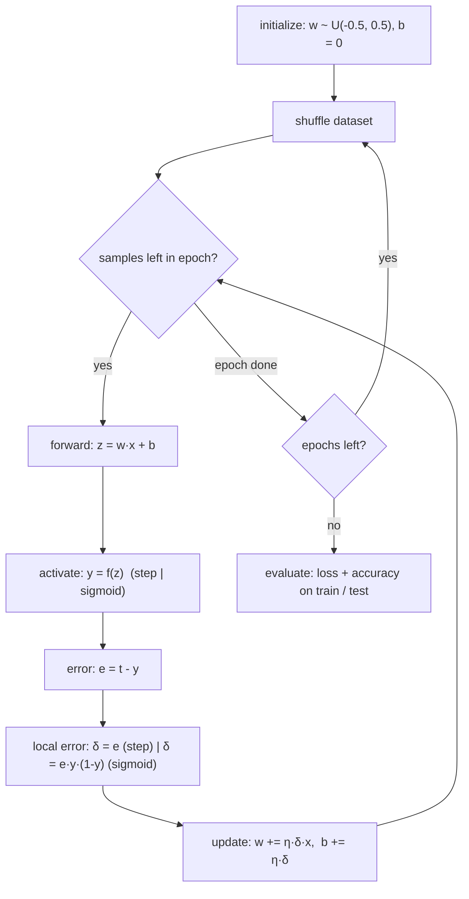
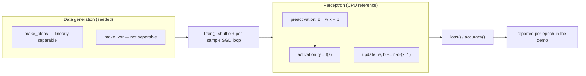

# v0.1 — Single Perceptron in C++

> A single artificial neuron, implemented from first principles in C++17: forward pass, two learning rules (classic perceptron rule and gradient descent), convergence verified against theory, and the XOR limitation demonstrated empirically.
>
> This folder is **self-contained and buildable** — stage 1 of 7 of **BareMetalMind**, a neural-network framework built on the bare metal.

---

## Abstract

This stage establishes the mathematical and engineering foundation for the entire project. A perceptron is a static, memoryless map `y = f(wᵀx + b)` whose parameters are adapted from data. Despite its simplicity, it contains — in miniature — every mechanism that the later stages scale up:

| v0.1 mechanism | Scaled-up form in later stages |
|---|---|
| Dot product `wᵀx + b` | GPU kernel (v0.2), tiled GEMM (v0.5) |
| Error signal `δ = (t − y)·y(1 − y)` | Backpropagation through layers (v0.4) |
| Batch update `w += η·Xᵀδ` | Parallel mini-batch training (v0.3, v0.4) |
| Linear-separability limit (XOR) | The motivating cliff for the MLP (v0.4) |

The full mathematical treatment — derivations, the Novikoff convergence bound with proof sketch, the empirical-risk framing, and the control-theoretic interpretation (adaptive-gain/LMS connection) — is in **[EXPLANATION.md](EXPLANATION.md)**.

---

## Theory summary

**Model.** Input **x** ∈ ℝⁿ, parameters θ = (**w**, b):

```
z = wᵀx + b          (pre-activation)
y = f(z)             (activation)
```

**Activations.** Step (`y = 1[z ≥ 0]`, the classic relay) and sigmoid (`y = 1/(1+e⁻ᶻ)`, with the self-derivative `f′ = y(1−y)`).

**Learning rules.**

```
Perceptron rule (step):      w ← w + η(t − y)x,   b ← b + η(t − y)
Gradient descent (sigmoid):  δ = (t − y)·y(1−y),  w ← w + ηδx,     b ← b + ηδ
```

The perceptron rule is subgradient descent on the convex surrogate `ℓ = max(0, −y*(wᵀx+b))`; the sigmoid rule is per-sample SGD on the squared loss.

**Convergence guarantee (Novikoff, 1962).** If the training set is linearly separable with margin γ and radius R = maxᵢ ‖(xᵢ, 1)‖, the perceptron rule makes at most `(R/γ)²` mistakes, after which its parameters stop changing. Invariant in η, independent of dimension n.

**Cost.** O(n) per forward pass; O(|D|·n) per training epoch.

---

## Architecture

```
v0.1/
├── EXPLANATION.md          full mathematical treatment
├── README.md               this file
├── CMakeLists.txt          CMake ≥ 3.10, C++17 — library + demo + tests
├── src/
│   ├── perceptron.h/.cpp   Perceptron class
│   └── dataset.cpp         make_blobs (separable), make_xor (not separable)
├── tests/
│   └── perceptron_tests.cpp   9 assert-based tests
└── examples/
    └── perceptron_demo.cpp    training demo with per-epoch logs
```

### How it works — the training loop



### Module architecture



**Design decisions.**

| Decision | Choice | Rationale |
|---|---|---|
| Scalar type | `float` | Matches `cl_float` in v0.2+; avoids a type migration across the roadmap |
| Weight init | `U(−0.5, 0.5)`, seeded `std::mt19937` | Reproducible runs; deterministic test suite |
| Failure mode | Exceptions, not asserts | Survives release builds (`NDEBUG`) |
| Sigmoid evaluation | naive `1/(1+e⁻ᶻ)` | Graceful under IEEE-754 (see EXPLANATION.md §9) |

---

## Build & Run

```bash
cmake -S . -B build -DCMAKE_BUILD_TYPE=Release
cmake --build build

./build/perceptron_tests     # assert-based test suite (9 tests)
./build/perceptron_demo      # training demo
ctest --test-dir build       # CTest-registered test run
```

No external dependencies. Any C++17 toolchain works (tested with GCC).

---

## Results

All 9 tests pass, including hand-computed checks of the forward pass (step and sigmoid) and single update steps for both rules, pinned to 1e-4.

**Demo output** (separable Gaussian blobs, 160/40 train/test, seed 42, η = 0.1) — representative excerpt:

```
=== Sigmoid + gradient descent on separable blobs ===
  epoch  1  loss 0.0015  accuracy 100.00%
  epoch  2  loss 0.0007  accuracy 100.00%
  ...
  epoch 20  loss 0.0001  accuracy 100.00%
  weights: w = (1.07, 1.38), b = -0.00
  train accuracy: 100.00%
  test  accuracy: 100.00%

=== Step + perceptron rule on separable blobs ===
  epoch  1  loss 0.0000  accuracy 100.00%
  weights: w = (0.13, 0.39), b = 0.10
  train accuracy: 100.00%

=== XOR: the failure case ===
  accuracy after 50 epochs: 53.25%
```

**Interpretation — three theoretically predicted behaviors, observed:**

1. **Monotone convergence (sigmoid).** Loss decreases 0.0015 → 0.0001 in 20 epochs; accuracy reaches 100% after epoch 1 (wide-margin separable data → small (R/γ)²).
2. **Termination, not oscillation (step rule).** The step perceptron reaches 100% within the first epoch and its weights freeze — the Novikoff bound is a mistake bound on a *terminating algorithm*.
3. **The XOR cliff.** The same optimizer plateaus at 53.25% — chance level. No learning rule can fix this; the model class itself is insufficient. This is the empirical motivation for v0.4.

---

## Advantages & disadvantages vs. the conventional approach

"Conventional" means solving the same task through an established framework — e.g. `sklearn.linear_model.Perceptron` or a one-layer `torch.nn.Linear` — where the arithmetic is hidden behind an API.

### Advantages of this implementation

| Advantage | Why it matters |
|---|---|
| Total visibility | every multiply–add, activation, and update is explicit code — no hidden library behavior to trust |
| Zero dependencies | builds anywhere with any C++17 compiler; no Python runtime, no framework install |
| Deterministic reproducibility | seeded RNG end to end; identical results on every machine and in every test run |
| A correctness oracle | this CPU path is the reference against which all GPU stages (v0.2+) are verified |
| Transferable understanding | the exact arithmetic becomes GPU kernels in v0.2+; the knowledge is structural, not incidental |
| Portfolio-grade evidence | hand-computed test expectations prove the math, not just the wiring |

### Disadvantages

| Disadvantage | Mitigation / roadmap hook |
|---|---|
| Far slower than optimized libraries — no SIMD tuning, single-threaded, no batching | batching in v0.3; GPU port in v0.2 |
| Model class limited to linear decision boundaries | full MLP + backpropagation in v0.4 |
| Gradients must be derived and coded by hand | deliberate; becomes the structural basis of backprop in v0.4 |
| Everything self-verified — no library guarantees to lean on | 9 hand-computed tests; the honest cost of owning the whole stack |

---

## Limitations & next steps

- **Linear decision boundary only** — resolved by the full MLP (v0.4) via backpropagation.
- **Single-sample updates** — the batch form `w += η·Xᵀδ` is already implicit in the math; v0.3 parallelizes it.
- **CPU scalar loop** — the forward pass is a dot product; v0.2 moves it to an OpenCL kernel with a CPU-vs-GPU benchmark harness.

---

Key sources: Rosenblatt (1962); Novikoff (1962); Minsky & Papert (1969); Widrow & Hoff (1960); Robbins & Monro (1951); Haykin (2009).
